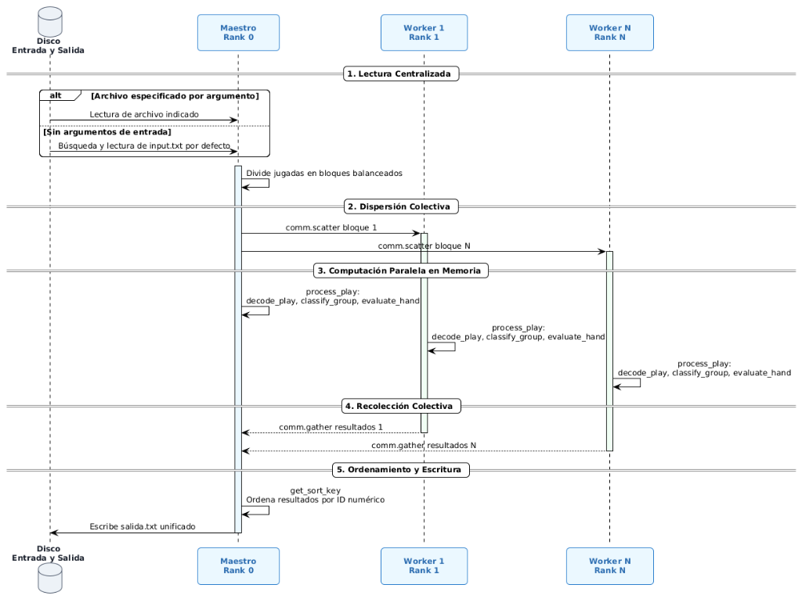

# Evaluación masiva de Mahjong (Proyecto 2026-01)

Este proyecto implementa un sistema distribuido en Python diseñado para procesar masivamente miles de configuraciones de jugadas de Mahjong. El sistema calcula las puntuaciones base, dobles, estilo de la mano e interpreta sintácticamente cada jugada basándose en las reglas del Mahjong (incluyendo Cantos Clásicos y Límites). Debido al alto volumen del dataset, el cálculo está paralelizado sobre un ambiente de paso de mensajes utilizando **MPI (`mpi4py`)**.

## Estructura del proyecto

```text
proyect_mohjong/
├── docs/                     # Enunciado, reglas y diagrama de arquitectura
│   └── diagrama_comunicacion # Diagrama de secuencia del flujo MPI
├── src/                      # Módulos y motor de evaluación
│   ├── __init__.py           # Paquete Python
│   ├── parser.py             # Decodificación y funciones de soporte (process_play, get_sort_key)
│   ├── mahjong_rules.py      # Constantes de juego y clasificación de grupos
│   └── scorer.py             # Motor de puntuación (base, dobles, cantos clásicos y Ramos Prince)
├── tests/                    # Pruebas y datasets
│   ├── data/                 # Datasets de prueba organizados
│   │   ├── input_maestro.txt
│   │   ├── soluciones_maestro.txt
│   │   └── test_readme.txt
│   └── test.py               # Script de pruebas automatizadas
├── main.py                   # Script ejecutable principal (orquestador MPI)
├── salida.txt                # Archivo unificado de salida generado por el proceso Maestro
├── requirements.txt          # Dependencias (mpi4py)
├── .gitignore
└── README.md
```

## 1. Arquitectura del sistema

La arquitectura está basada en el paradigma **Maestro-Trabajador (Master-Worker)**. 

Elegimos esta arquitectura porque evaluar miles de jugadas de Mahjong es un trabajo que se puede dividir muy fácilmente. Cada línea del archivo es una jugada independiente, así que no hay necesidad de que los procesos se comuniquen entre sí para resolverlas. 

Para organizarlo, dividimos los roles en dos partes muy claras:

*   **El proceso maestro (Rank 0):** Es como el director de la orquesta. Él es el único que interactúa con los archivos. Lee todas las jugadas de golpe, las pica en pedazos iguales y le reparte un pedazo a cada trabajador. Al final, se queda esperando a que todos terminen, recoge las respuestas, las vuelve a armar en el orden correcto y guarda el archivo de salida. Centralizar la lectura y escritura en este nodo evita que todos los procesos intenten escribir al mismo tiempo y colapsen el sistema.
*   **Los procesos trabajadores (Workers):** Son los obreros matemáticos. Cada uno recibe su pedazo de texto, lo procesa línea por línea sacando las cuentas, y cuando termina, empaqueta sus resultados y se los devuelve al Maestro.

## 2. Funcionalidad y lógica de cálculo

El sistema está compuesto por una serie de funciones especializadas que dividen el problema de evaluación del Mahjong en tareas pequeñas y lógicas.

### Funciones principales y su propósito

1. **`decode_play(line: str) -> dict`**: Ubicada en [src/parser.py](src/parser.py). Su propósito es "traducir" la cadena de texto plana del archivo de entrada y convertirla en un diccionario estructurado, aislando los vientos, los grupos de mesa, las flores y la pieza ganadora.
2. **`classify_group(group_str: str) -> dict`**: Ubicada en [src/mahjong_rules.py](src/mahjong_rules.py). Analiza un grupo individual (ej: `[P2-P2-P2]`) determinando si es un Pung, Kong, Chow o Par (Ojos), cuál es su pinta base, si pertenece a los honores, y si está en estado oculto o abierto sobre la mesa.
3. **`detect_classic(groups, flowers, own_wind, round_wind, winning_piece) -> tuple`**: Ubicada en [src/scorer.py](src/scorer.py). Su propósito es auditar la mano completa para verificar si coincide con las estrictas configuraciones de los **Cantos Clásicos o Límites** (ej: 13 Maravillas, Gran Seguidilla Real). Si encaja, devuelve el puntaje fijo de esa mano.
4. **`calculate_base_points(groups, flowers, has_chow) -> tuple`**: Ubicada en [src/scorer.py](src/scorer.py). Escanea los grupos de la mano para sumar los puntos "duros" (cuenta base). Otorga puntos por tener flores, bonos matemáticos por tener kongs y pungs (especialmente si son honores), y añade el bono fijo por haber logrado el Mahjong.
5. **`calculate_doubles(groups, flowers, own_wind, round_wind, has_chow) -> tuple`**: Ubicada en [src/scorer.py](src/scorer.py). Escanea la mano buscando combinaciones exponenciales. Otorga "dobles" si la mano es Limpia, Sucia, si hay ramilletes de flores completas, o tríos de dragones (Escolares Mayores/Menores).
6. **`evaluate_hand(parsed_hand: dict) -> dict`**: Ubicada en [src/scorer.py](src/scorer.py). Es el punto de entrada central del motor de reglas. Su propósito es orquestar a todas las demás funciones de puntuación y aplicar la fórmula matemática final.
7. **`process_play(line: str) -> tuple`**: Ubicada en [src/parser.py](src/parser.py). Función de apoyo de alto nivel que encapsula todo el pipeline (decodificación, clasificación de grupos y evaluación) para una jugada individual.
8. **`get_sort_key(result_item) -> int`**: Ubicada en [src/parser.py](src/parser.py). Función auxiliar global que permite ordenar los resultados numéricamente por su ID.

### ¿Cómo trabajan en conjunto para sacar las cuentas? (El ciclo completo)

La lógica funciona como una cadena de montaje industrial perfecta. Cuando un proceso trabajador recibe una línea de texto cruda, ocurre exactamente el siguiente flujo de inicio a fin:

**Paso 1: Extracción léxica**
El orquestador (`main.py`) toma la línea y se la pasa a `decode_play`. Esta función usa herramientas de separación de cadenas para extraer las partes del texto (ej: ID de la jugada, vientos, piezas en la mesa, flores) y las devuelve estructuradas en un diccionario nativo de Python para que dejen de ser un simple texto.

**Paso 2: Análisis detallado de grupos**
Antes de hacer matemáticas, el sistema necesita saber qué significa cada grupo. El orquestador hace un bucle sobre cada grupo extraído y se los pasa a `classify_group`. Esta función mira si, por ejemplo, `[P2-P2-P2]` es un Pung, si pertenece a la pinta de Círculos (P), y si sus corchetes indican que está abierto. Toda esta radiografía detallada se anexa al diccionario.

**Paso 3: Evaluación de la mano**
El diccionario, ahora totalmente desglosado y clasificado, entra a `evaluate_hand`. Aquí empieza el árbol de decisiones matemáticas:
1. Primero, se le hace una consulta a `detect_classic()`. Si esta función detecta que las piezas forman un patrón exacto como los "7 Samuráis", corta el proceso y devuelve el puntaje de límite estipulado.
2. Si no es clásica, delega el trabajo a `calculate_base_points()` para contar los puntos duros (flores y pungs).
3. Luego, le pasa la mano a `calculate_doubles()` para contar cuántos multiplicadores exponenciales posee (por ejemplo, si la mano es Limpia o tiene Escolares).

**Paso 4: La fórmula matemática final (Estándar Ramos Prince)**
Dentro de ese mismo `evaluate_hand`, habiendo recolectado la base y los dobles de sus sub-funciones, se aplica el cálculo y redondeo según las reglas oficiales:
1. La **cuenta base** se redondea a la decena más cercana (`int(round(raw_base / 10.0) * 10)`).
2. Para manos tradicionales, el cálculo exponencial es: `raw_total = base * (2 ** doubles)`.
3. Para manos clásicas con puntaje base menor a 15.000 puntos, si el jugador es viento Este (`E`), la mano cobra doble (1 doble: `total = base * 2`).
4. En manos tradicionales, el **puntaje total** se redondea a la centena más cercana (`int(round(raw_total / 100.0) * 100)`).
5. Se aplica el **tope máximo oficial** del juego (20.000 puntos).

```python
# Fórmula oficial y redondeo Ramos Prince para manos tradicionales:
raw_total = base * (2 ** doubles)

# Redondeo a la centena más cercana
total = int(round(raw_total / 100.0) * 100)

# Tope máximo
if total > MAX_TOTAL_POINTS:
    total = MAX_TOTAL_POINTS
```

**Paso 5: Ensamblaje de la respuesta**
Terminada la matemática, `evaluate_hand` le devuelve al orquestador tres datos vitales: el `total` numérico, el `estilo` (Tradicional o el nombre del Clásico), y un arreglo de `log` (bitácora detallada de los cálculos). El orquestador (`main.py`) toma esos datos y los ensambla de vuelta en una cadena de texto, lista para viajar por la red:
```python
# Así se empaca el resultado final para enviarlo en el comm.gather
resultado_final = f"{visual_original} | {base} | {doubles} | {total} | {estilo} | {log}"
```

De esta manera el ciclo se completa: empieza con una cadena de texto plana en la entrada, se expande en diccionarios complejos para calcular las matemáticas puras, y vuelve a comprimirse en una cadena de texto enriquecida para la salida.


## 3. Mensajes involucrados (comunicaciones MPI)

En lugar de enviar mensajitos individuales por cada línea de texto (lo cual saturaría la red), decidimos usar **operaciones colectivas** para enviar paquetes grandes de información de una sola vez. Todo el ciclo de vida funciona con dos grandes mensajes:

1. **La dispersión (`comm.scatter`):** El Maestro agarra la lista gigante de jugadas y la pica. Si hay 4 procesos corriendo, hace 4 listas más pequeñas. Luego lanza un "scatter", que es básicamente un envío masivo donde le tira a cada proceso su lista correspondiente en un solo movimiento.
2. **La recolección (`comm.gather`):** Cuando los trabajadores terminan de sacar sus cuentas, tienen una lista de resultados listos. A través del "gather", le devuelven todos esos pedazos al Maestro de un solo golpe. La gran ventaja del gather es que automáticamente respeta el orden original de los procesos, garantizando que el archivo de salida mantenga el mismo orden exacto que el de entrada.

### Diagrama de comunicación y flujo MPI



### Ejemplo práctico de entrada y salida

Para entender cómo estos mensajes transportan y transforman la data, veamos un caso real de lo que viaja por la red:

**Lo que entra al sistema (lo que envía el Maestro en el scatter):**
```text
1 [E / E] [C2-C3-C4] [C5-C5-C5] [C2-C2-C2] [C8-C8-C8] (C6-C6) <G3 R1 R4> *C6*
```
*¿Qué es esto?* Es una cadena de texto plana. Nos indica que es la jugada 1, que el viento es Este, los grupos sobre la mesa, las tres flores conseguidas y que la pieza ganadora fue C6.

**La transformación y el cálculo matemático (lo que ocurre dentro del Trabajador):**
El trabajador recibe esa línea, la desarma, e identifica lo siguiente:
*   **Grupos:** Un Chow `[C2-C3-C4]`, tres Pungs de Caracteres `[C5-C5-C5]`, `[C2-C2-C2]`, `[C8-C8-C8]`, y un par de `(C6-C6)`. Como ves, todas las fichas pertenecen a una sola familia (Caracteres "C").
*   **Flores:** Tiene 3 flores `<G3 R1 R4>`. La R1 es la "Roja 1", que corresponde numéricamente al viento Este.
*   **Viento del Jugador:** Es viento Este `[E / E]`.

Con esto, el sistema saca las cuentas reales paso a paso:
1. **Puntos Base (38 brutos → 40 redondeados):** 6 puntos por los tres Pungs descubiertos (2 pts cada uno por ser pintas simples C2, C5, C8) + 20 puntos de bono por Mahjong con Chow + 12 puntos por las 3 flores. Total bruto: 38 puntos, que se redondea a la decena más cercana (**40 puntos base**).
2. **Dobles o Multiplicadores (4 en total):** 1 doble por Flor Propia detectada (R1 con viento Este) + 3 dobles por Mahjong Limpio (todas las fichas son de una misma pinta usando Chows y Pungs). Total: **4 dobles**.
3. **Fórmula Matemática:** La Base `40` se multiplica por 2 elevado a los `4` dobles ($40 \times 16 = 640$). Finalmente, según el estándar Ramos Prince, se redondea a la centena más cercana: **`600` puntos**.

**Lo que sale del sistema (lo que consolida el Maestro en `salida.txt`):**
```text
1 [E / E] [C2-C3-C4] [C5-C5-C5] [C2-C2-C2] [C8-C8-C8] (C6-C6) <G3 R1 R4> *C6* | 40 | 4 | 600 | TRADICIONAL | ['2 pung abierto pinta 2 ', '4 pung abierto pinta 2 ', '6 pung abierto pinta 2 ', '26 mahjong con chow 20 ', '38 flores: 3 para 12 puntos', 'Total puntos: 38 para 40', '[+] 1 Doble: Flor Propia detectada (R1)', '[+] 3 Dobles: MAH-JONGG LIMPIO (Pungs y Chows de una pinta)', 'Total mano: 640 para 600']
```

## 4. Formato del archivo de salida (`salida.txt`)

El archivo de salida unificado cumple estrictamente con el formato estipulado en las especificaciones oficiales:

1. **Cada jugada en una sola línea**, con los campos delimitados por barras verticales `|`:
   ```text
   # Visual Completo | Cuenta Base | Dobles | Total | Estilo de Mano | [Historial/log]
   ```
2. **Última línea de tiempo de cálculo**: Justo después de la última jugada, se incorpora la línea de métricas temporales:
   ```text
   Fecha inicio | Fecha fin | Tiempo en segundos
   ```
   *(Ejemplo: `2026-10-28 16:12:49 | 2026-10-28 16:12:49 | 0.0022`)*

## 5. Instrucciones de ejecución

El programa debe correrse sobre el ambiente virtual o entorno que contenga `mpi4py`. Para ejecutar en paralelo utilizando por ejemplo 4 procesos:

```bash
# Especificando archivo de entrada y salida opcional:
mpiexec -n 4 python main.py <archivo_de_entrada.txt> [archivo_de_salida.txt]

# Ejecución por defecto (busca automáticamente input.txt o input_maestro.txt y genera salida.txt):
mpiexec -n 4 python main.py
```

## 6. Cobertura de Manos Clásicas

El motor de reglas ([src/scorer.py](src/scorer.py)) implementa y valida con exactitud las **16 Manos Clásicas y Límites** definidas en la especificación oficial:

| Mano Clásica | Puntaje Base | Condición de duplicación para viento Este |
| :--- | :---: | :---: |
| Gran Seguidilla Real | 2.500 pts | Duplica ($2 \times$ base) si es viento Este |
| 7 Samuráis | 2.500 pts | Duplica ($2 \times$ base) si es viento Este |
| 13 Maravillas | 2.500 pts | Duplica ($2 \times$ base) si es viento Este |
| Ases y Nueves | 5.000 pts | Duplica ($2 \times$ base) si es viento Este |
| Jaspe Verde | 5.000 pts | Duplica ($2 \times$ base) si es viento Este |
| Hijos de la Noche | 7.500 pts | Duplica ($2 \times$ base) si es viento Este |
| Tifón Oriental | 10.000 pts | Duplica ($2 \times$ base) si es viento Este |
| Rosa de los Vientos | 10.000 pts | Duplica ($2 \times$ base) si es viento Este |
| Armonía Celeste | 10.000 pts | Duplica ($2 \times$ base) si es viento Este |
| Jaspe Rojo | 15.000 pts | Puntaje fijo (Tope directo) |
| Bendición Celestial | 15.000 pts | Puntaje fijo (Tope directo) |
| Gran Muralla China | 15.000 pts | Puntaje fijo (Tope directo) |
| Ciudad Prohibida | 15.000 pts | Puntaje fijo (Tope directo) |
| Grandes Samuráis | 20.000 pts | Puntaje fijo (Tope máximo) |
| La Flor del Cerezo | 20.000 pts | Puntaje fijo (Tope máximo) |
| Pescando la Luna del Fondo del Mar | 20.000 pts | Puntaje fijo (Tope máximo) |

## 7. Pruebas automatizadas

El proyecto incluye una suite de pruebas automatizadas en la carpeta [tests/](tests/) que valida tanto las 16 manos clásicas como la consistencia del 100% de las jugadas del examen maestro:

```bash
python -m tests.test
```

